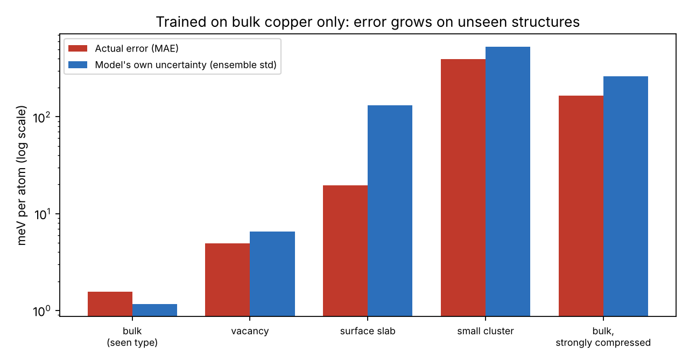
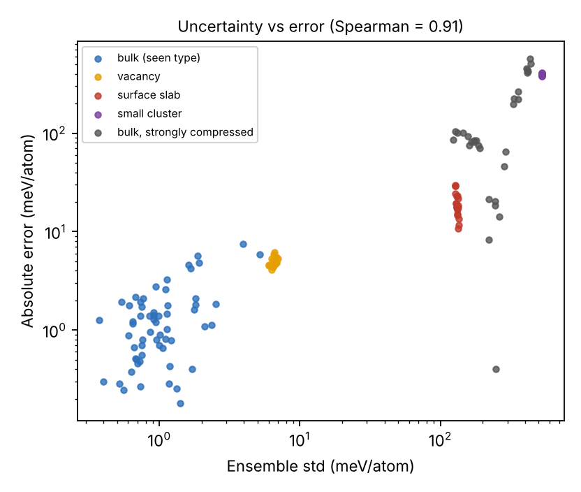

# MLIP trust demo: when can you trust a machine-learned potential?

A small learning project. It trains a neural-network potential on bulk copper, then tests it on structures it has not seen (vacancy, surface slab, small cluster, compressed bulk) and checks whether the disagreement between ensemble members flags the bad predictions.

Live page: https://ahmadbey678.github.io/mlip-trust-demo/





## What it does

- Ground truth: ASE `EMT` potential for Cu (a cheap stand-in for DFT, not DFT)
- Training data: 300 bulk cells with random lattice constants and random atomic displacements
- Descriptors: Behler-Parrinello-style radial and angular symmetry functions
- Model: ensemble of 8 small MLPs (scikit-learn, L-BFGS) predicting energy per atom
- Uncertainty: standard deviation across the 8 models
- Results (seeded, reproducible): bulk MAE about 1.6 meV/atom; cluster about 395 meV/atom; Spearman correlation between ensemble std and error 0.91 over 150 test structures

## Run

```
pip install -r requirements.txt
python mlip_demo.py        # about 20 s, writes results.json
python make_figures.py    # writes the two PNGs
python -m http.server     # then open http://localhost:8000 to see the page
```

## Files

- `mlip_demo.py`: data generation, descriptors, training, evaluation
- `make_figures.py`: draws the figures from `results.json`
- `results.json`: saved results, read by `index.html`
- `index.html`: the project page (served by GitHub Pages)

## Limits

EMT is not DFT; one element only; energy per atom from descriptors averaged over atoms (not a sum of per-atom energies); no forces; small test sets. The first run used the Adam solver and converged poorly, so I switched to L-BFGS and kept that result. The ensemble std is a warning signal, not a calibrated error bar (it overestimates the error on the surface slab).

## License

MIT. See `LICENSE`.
